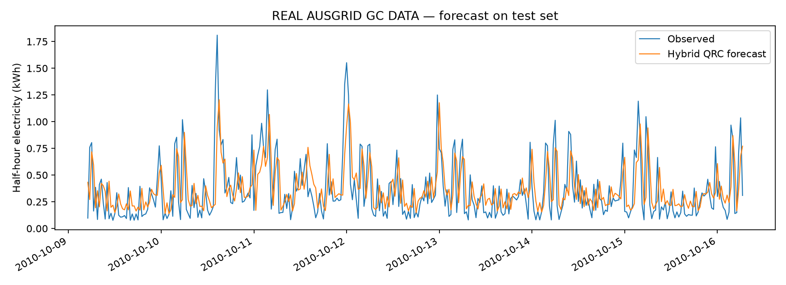
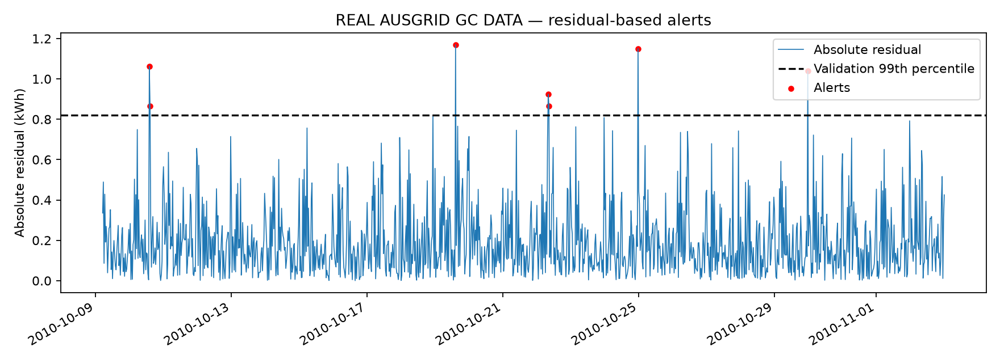

# Quantum Reservoir Computing for Residual-Based Anomaly Detection in Ausgrid Smart-Meter Load Data

**Author:** Merey Abutalipova  
**University:** Amity University Tashkent  
**Programme:** B.Tech (Computer Science and Engineering)

## Project Overview

This project investigates the use of Quantum Reservoir Computing (QRC) for detecting anomalies in electricity consumption data from the Ausgrid smart-meter dataset.

A hybrid QRC model is used to predict electricity consumption. The difference between actual and predicted consumption is then analyzed to identify unusual observations.

The proposed approach is compared with classical Ridge Regression.

## Dataset

- Source: Ausgrid Solar Home Electricity Data
- Customer: 1
- Consumption category: General Consumption (GC)
- Measurements: 6,000
- Training samples: 3,571
- Validation samples: 1,190
- Test samples: 1,191

The original dataset is available from [Ausgrid](https://www.ausgrid.com.au/Industry/Our-Research/Data-to-share/Solar-home-electricity-data).

## Methodology

1. Load and preprocess Ausgrid smart-meter data.
2. Prepare time-series features.
3. Simulate a three-qubit quantum reservoir.
4. Train a classical readout using Ridge Regression.
5. Generate electricity consumption forecasts.
6. Calculate forecasting residuals.
7. Detect anomalies using a validation-based threshold.
8. Compare QRC with classical Ridge Regression.

## Experimental Results

| Metric | Hybrid QRC | Ridge Regression |
|---|---|---|
| MAE (kWh) | 0.19306 | 0.19342 |
| RMSE (kWh) | 0.25901 | 0.25922 |
| Precision (injected anomalies) | 0.8793 | 0.8644 |
| Recall (injected anomalies) | 0.8644 | 0.8644 |
| F1-score (injected anomalies) | 0.8718 | 0.8644 |

The QRC model achieved slightly lower forecasting errors than the classical baseline. However, the differences were small and do not demonstrate quantum computational advantage.

Anomaly detection precision, recall, and F1-score were evaluated using artificially injected anomalies, not independently verified real-world meter faults.

## Installation

Install Python 3.11 or later and the required dependencies:

```bash
pip install -r requirements.txt
```

## Running the Project

After obtaining the Ausgrid dataset, run:

```bash
python main.py --csv 2011.csv --customer 1 --limit 6000 --out outputs
```

## Output Files

The program generates:

- `forecast.png` — actual and predicted electricity consumption.
- `anomalies.png` — residual-based anomaly detection.
- `metrics.json` — forecasting and anomaly detection metrics.
- `test_predictions.csv` — detailed prediction results.

## Technologies

Python, NumPy, pandas, scikit-learn, Matplotlib and a simulated quantum state-vector reservoir.

## Limitations

The experiment covers one customer and a limited observation period. The results do not establish that QRC consistently outperforms classical forecasting models.

## References

Fujii, K., & Nakajima, K. (2017). *Harnessing disordered-ensemble quantum dynamics for machine learning*. Physical Review Applied, 8(2), 024030.

Ausgrid Solar Home Electricity Data.


## Experimental Visualizations

### QRC Electricity Consumption Forecast



The figure compares observed electricity consumption with predictions produced by the Hybrid QRC model.

### Residual-Based Anomaly Detection



The figure shows absolute forecasting residuals, the validation-based detection threshold, and flagged observations.
  
